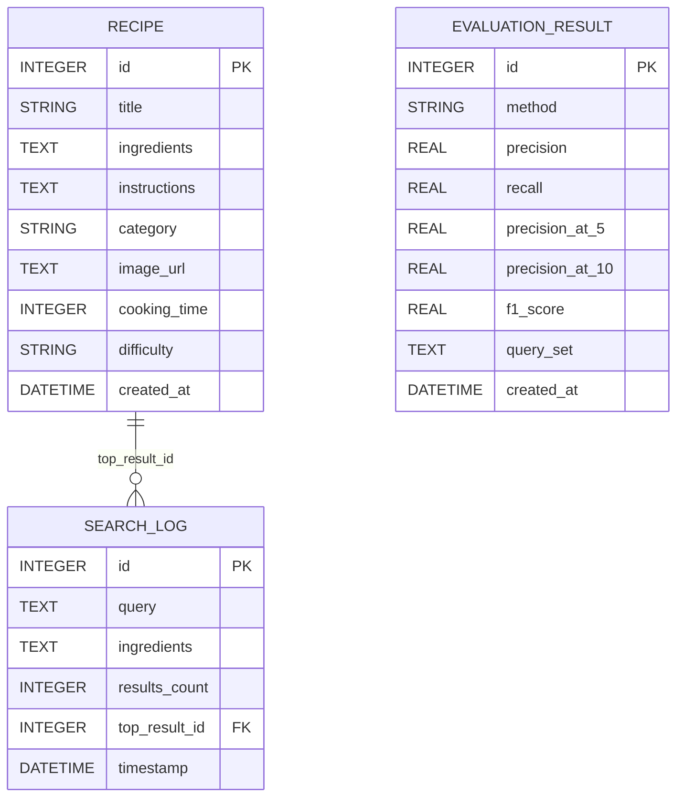

# ERD — Smart Recipe Planner Database

## Table Descriptions

### RECIPE
Primary document store. Each recipe is indexed by the BM25 engine at startup.

| Field | Type | Description |
|-------|------|-------------|
| id | INTEGER PK | Auto-increment primary key |
| title | TEXT | Recipe name (indexed, weighted ×3 in BM25) |
| ingredients | TEXT | Comma/newline-separated ingredients (weighted ×2 in BM25) |
| instructions | TEXT | Step-by-step cooking instructions |
| category | TEXT | Goreng / Rebus / Tumis / Panggang |
| image_url | TEXT | Unsplash CDN URL |
| cooking_time | INTEGER | Minutes |
| difficulty | TEXT | Easy / Medium / Hard |
| created_at | DATETIME | Auto-set on insert |

### SEARCH_LOG
Every search query is logged for analytics and search count tracking.

| Field | Type | Description |
|-------|------|-------------|
| id | INTEGER PK | |
| query | TEXT | Raw joined query string |
| ingredients | TEXT | JSON array of ingredient strings |
| results_count | INTEGER | Number of BM25 results returned |
| top_result_id | INTEGER FK | Recipe.id of the top-ranked result |
| timestamp | DATETIME | UTC timestamp |

### EVALUATION_RESULT
Stores results of each IR evaluation run for historical comparison.

| Field | Type | Description |
|-------|------|-------------|
| id | INTEGER PK | |
| method | TEXT | "BM25 tanpa Stemming" / "BM25 dengan Stemming" / "TF-IDF dengan Stemming" |
| precision | REAL | Average precision across all test queries |
| recall | REAL | Average recall |
| precision_at_5 | REAL | P@5 |
| precision_at_10 | REAL | P@10 |
| f1_score | REAL | Harmonic mean of P and R |
| query_set | TEXT | JSON list of queries used |
| created_at | DATETIME | |
